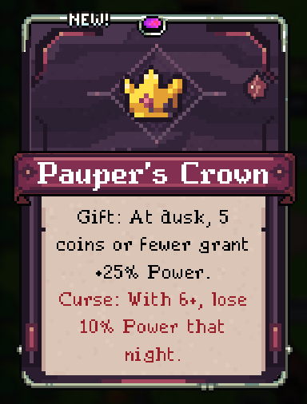
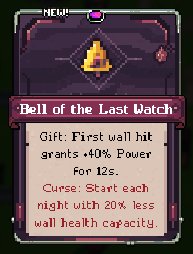
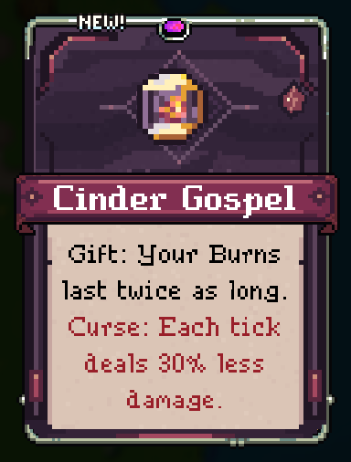
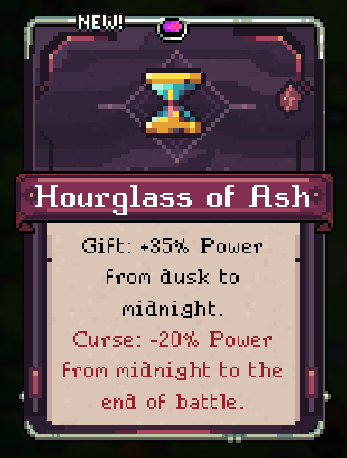
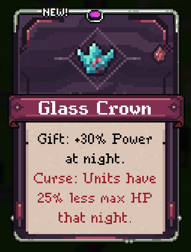
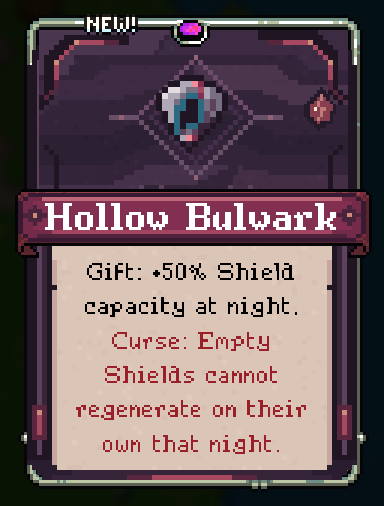
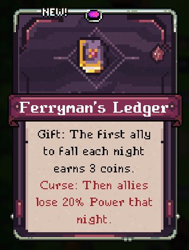
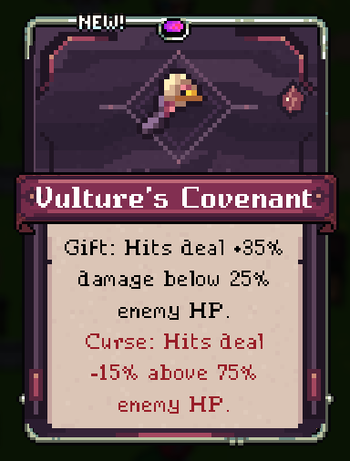
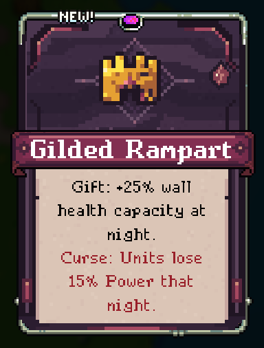
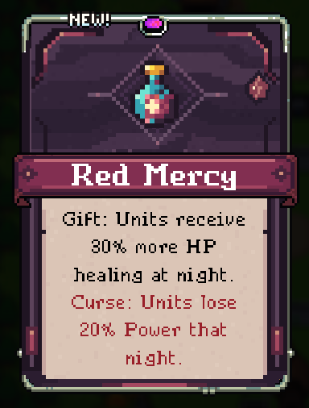

# Cursed Relics

Ten cursed relics join Super Fantasy Kingdom’s native reward cards. Each offers a run-wide Gift and a red Curse.

## Features

- Ten relics with original pixel-art icons, a plum-and-crimson frame, and native card focus.
- The ten effects cover unit Power, wall capacity, Burn, Shields and healing. Active Power and wall capacity modifiers combine multiplicatively.
- Native Continue restores owned relic IDs. An unclaimed native chest can reopen with the same eligible row. A deliberate reroll replaces that row.

## How to Use

1. Open a boss, kingdom, or worker relic chest with three eligible choices. A cursed relic can take one slot at a default chance of 35%. Bell of the Last Watch and Gilded Rampart require a built wall.
2. Read the Gift and Curse together before choosing. Click a card or use the game's controller focus and confirm buttons. In a cursed row, Tab and Shift+Tab focus cards and Enter chooses the focused card.
3. After the first modded launch, adjust `CursedChancePercent` under `[Rewards]` in `BepInEx/config/gkj.cursedrelics.cfg`. Set it to `0` to stop new cursed offers. Keep the mod enabled when continuing a kingdom that owns its relics.

## Screenshots

All ten relic rewards appear below at 1.5× UI scale. Each card’s Gift and Curse is also available as selectable text.

### Pauper's Crown

**Gift**  At dusk, 5 coins or fewer grant +25% Power.

**Curse**  With 6+, lose 10% Power that night.

### Bell of the Last Watch

**Gift**  First wall hit grants +40% Power for 12s.

**Curse**  Start each night with 20% less wall health capacity.

### Cinder Gospel

**Gift**  Your Burns last twice as long.

**Curse**  Each tick deals 30% less damage.

### Hourglass of Ash

**Gift**  +35% Power from dusk to midnight.

**Curse**  -20% Power from midnight to the end of battle.

### Glass Crown

**Gift**  +30% Power at night.

**Curse**  Units have 25% less max HP that night.

### Hollow Bulwark

**Gift**  +50% Shield capacity at night.

**Curse**  Empty Shields cannot regenerate on their own that night.

### Ferryman's Ledger

**Gift**  The first ally to fall each night earns 3 coins.

**Curse**  Then allies lose 20% Power that night.

### Vulture's Covenant

**Gift**  Hits deal +35% damage below 25% enemy HP.

**Curse**  Hits deal -15% above 75% enemy HP.

### Gilded Rampart

**Gift**  +25% wall health capacity at night.

**Curse**  Units lose 15% Power that night.

### Red Mercy

**Gift**  Units receive 30% more HP healing at night.

**Curse**  Units lose 20% Power that night.

## Compatibility

- Tested on Super Fantasy Kingdom **0.8.068** with BepInEx 5 at 1× and 1.5× UI scale using mouse, keyboard, and virtual controller input.
- [Weekly Contracts](https://thunderstore.io/c/super-fantasy-kingdom/p/GKJ/WeeklyContracts/) can offer one cursed relic when it commits an eligible relic reward. [Amaya Without Cooldown](https://thunderstore.io/c/super-fantasy-kingdom/p/GKJ/AmayaWithoutCooldown/) keeps Amaya’s ordinary stock, and [Relic Loadout Journal](https://thunderstore.io/c/super-fantasy-kingdom/p/GKJ/RelicLoadoutJournal/) shows cursed relic names, icons, and effects.
- [Hold the Line](https://thunderstore.io/c/super-fantasy-kingdom/p/GKJ/HoldTheLine/) 0.2.3 keeps its paid relic wager ordinary by default. Enable `AllowPaidWager` to allow a cursed option there. Wall capacity changes preserve the wager. A hit that removes wall HP counts as damage.
- [Nights of Terror](https://thunderstore.io/c/super-fantasy-kingdom/p/GKJ/NightsOfTerror/) 0.1.3 can add a midnight reinforcement wave. [Cursed Equipment](https://thunderstore.io/c/super-fantasy-kingdom/p/GKJ/CursedEquipment/) adds separate cursed gear through the Blacksmith. Both mods are optional.

## Installation

1. Choose **Install with App** on [Thunderstore](https://thunderstore.io/c/super-fantasy-kingdom/p/GKJ/CursedRelics/) or install **CursedRelics** by **GKJ** from your Super Fantasy Kingdom profile.
2. Allow the manager to install [BepInExPack](https://thunderstore.io/c/super-fantasy-kingdom/p/BepInEx/BepInExPack/) and [HideManagerGameObject Config](https://thunderstore.io/c/super-fantasy-kingdom/p/BepInEx/HideManagerGameObject_Config/).
3. Start the game modded and load your kingdom. For manual installation, extract `plugins/CursedRelics.dll` into the profile's `BepInEx/plugins` directory.

See the [contribution guide](https://raw.githubusercontent.com/GKJ-Super-Fantasy-Kingdom/cursed-relics/v0.2.11/CONTRIBUTING.md) for local builds and issue reports. The original mod code is released under the [MIT License](https://raw.githubusercontent.com/GKJ-Super-Fantasy-Kingdom/cursed-relics/v0.2.11/LICENSE). Super Fantasy Kingdom and its assets retain their respective ownership.

## Support

[Support GKJ Games on Ko-fi](https://ko-fi.com/gkj_games)
